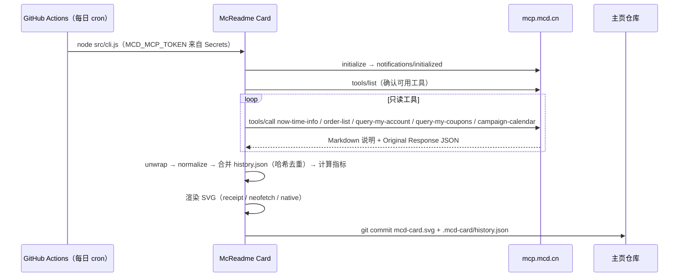

# MCP 集成说明

## 使用的 MCP Server

| 项目 | 值 |
|---|---|
| Server | 麦当劳中国 MCP Server（`mcd-mcp`） |
| 地址 | `https://mcp.mcd.cn` |
| 传输 | Streamable HTTP，JSON-RPC 2.0，协议版本 `2025-06-18` |
| 鉴权 | `Authorization: Bearer ${MCD_MCP_TOKEN}`（见 `mcp-config.example.json`） |
| 客户端 | 自研零依赖客户端 [`src/mcp-client.js`](./src/mcp-client.js)，支持 JSON 与 SSE 两种响应、429 指数退避 |

## 使用的 Tool（全部只读）

| Tool | 用途 | 实测返回结构 → 卡片字段 |
|---|---|---|
| `now-time-info` | 以服务器北京时间作为"今天"，用于贡献图、今日活动、生成时间 | `data.formatted` → 生成时间 |
| `order-list` | 历史订单，计算职级、主力依赖、技术栈、发版时段、贡献图 | `data.list[].{orderId, createTime, orderType, orderProductList[].{productName, quantity, comboItemList}}` |
| `query-my-account` | 积分账户 | `data.availablePoint` → 可用积分；`data.currentMouthExpirePoint` → 本月到期 |
| `query-my-coupons` | 卡包优惠券数量 | `data.totalCount` → 可用优惠券 |
| `campaign-calendar` | 今日进行中的活动 | `data.dailyList[date=今天].events[].articleDto.title` → NOW SERVING（每日轮换） |

**明确不调用**的写操作：`create-order`、`cancel-order`、`auto-bind-coupons`、`draw-lottery`、`mall-create-order`、`party-order-create`、`delivery-create-address`。客户端用白名单 `READ_ONLY_TOOLS` 在代码层面拦截，`test/card.test.js` 中有对应测试。

## 调用流程

### 返回解析

麦当劳 MCP 的工具返回是一段 Markdown：先是字段说明，原始 JSON 放在 `## Original Response` 之后。[`src/unwrap.js`](./src/unwrap.js) 按以下顺序解析：

1. `structuredContent`
2. 纯 JSON 文本
3. `Original Response` 之后的 fenced JSON
4. 括号配平提取的 JSON

[`src/normalize.js`](./src/normalize.js) 以实测字段为主，并保留候选键兜底，避免服务端字段调整导致卡片失效。

活动标题中的 emoji 和"数学粗体"数字（如 `𝟗.𝟗`）会经过 NFKC 归一化后去除，保证 SVG 在各平台排版一致。

### Agent / Skill 路径

在 WorkBuddy 等已连接 `mcd-mcp` 的 Agent 中，由 Agent 调用上述只读工具，把原文写入 `.local/bundle.json`，再执行 `node src/cli.js --from .local/bundle.json`。详见 [`skills/mcd-readme-card/SKILL.md`](./skills/mcd-readme-card/SKILL.md)。

## 业务价值

| 对用户 | 对麦当劳生态 |
|---|---|
| 积分**本月到期**醒目提醒，减少积分白白过期 | 每张挂在主页的卡片都是对麦当劳 MCP 的一次自然曝光，面向开发者群体 |
| 优惠券数量常驻可见，提醒用券 | 「NOW SERVING」每天轮换展示官方进行中的活动，让活动触达开发者 |
| 以工程师熟悉的方式（职级、技术栈、贡献图）回顾自己的饮食偏好 | 职级只奖励"探索新品"，引导用户尝试更多品类，而不是多吃 |
| 一次配置，每天自动刷新，零维护 | 展示了 MCP 在"内容生成 + 自动化工作流"场景中的用法，可供其他开发者参考 |

## 数据与隐私

- 只读调用，Token 只存于 GitHub Secrets 或本地环境变量。
- Actions 日志不输出原始返回，只输出单数和职级。
- `history.json` 只保存日期、小时、渠道、餐品名和订单号哈希，不保存门店、金额、地址。
- 支持 `privacy: strict` 和 `hide` 隐藏任意模块。
