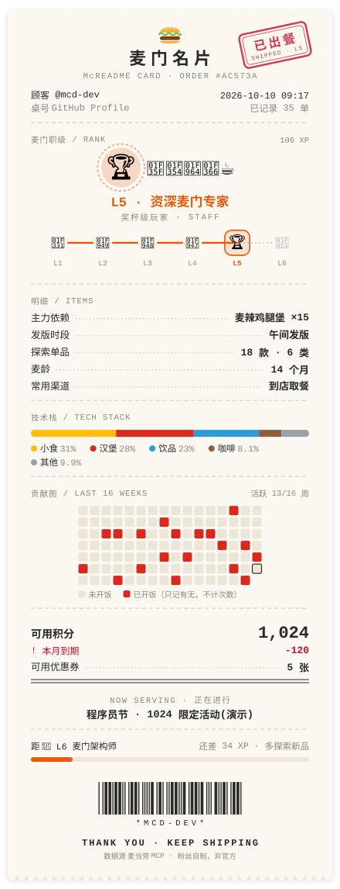

<div align="center">

# 麦门名片 · McReadme Card

**把你的麦门履历，挂上 GitHub 主页。**

一张每天自动刷新的 SVG 卡片：麦门职级、主力依赖、技术栈、贡献图、积分到期提醒、今日活动。<br/>
数据实时来自 [麦当劳 MCP](https://github.com/M-China/mcd-mcp-server)，全程只读。



`receipt` · 热敏小票主题

</div>

---

## 三套主题

<table>
<tr>
<td align="center" width="50%"><br/><code>neofetch</code> · 终端风，给喜欢 rice 桌面的你</td>
<td align="center" width="50%"><br/><code>native</code> · GitHub 原生风，跟随系统深浅色，和 github-readme-stats 并排毫不违和</td>
</tr>
</table>

> 以上示例使用内置的虚构演示数据生成（`npm run demo`）。

## 30 秒挂上你的主页

**1. 申请麦当劳 MCP Token**

登录 [open.mcd.cn/mcp](https://open.mcd.cn/mcp)，进入控制台激活并复制 Token。

**2. 把 Token 存进主页仓库的 Secrets**

打开你的主页仓库（与你的用户名同名，例如 `octocat/octocat`）：
`Settings → Secrets and variables → Actions → New repository secret`。名称填 `MCD_MCP_TOKEN`，值粘贴 Token。

**3. 添加工作流**

把 [`docs/profile-workflow.yml`](./docs/profile-workflow.yml) 复制到主页仓库的 `.github/workflows/mcd-card.yml`：

```yaml
on:
  schedule:
    - cron: '17 1 * * *' # 每天北京时间 09:17 刷新
  workflow_dispatch:
permissions:
  contents: write
jobs:
  card:
    runs-on: ubuntu-latest
    steps:
      - uses: actions/checkout@v4
      - uses: colorfulee/McReadme-Card@main
        with:
          mcd_token: ${{ secrets.MCD_MCP_TOKEN }}
          theme: receipt # 可选 receipt / neofetch / native，逗号分隔可生成多张
```

到 Actions 页面手动运行一次。

**4. 在主页 README 里引用**

```markdown

```

完成。以后每天早上，你的麦门名片会自动刷新。

## 卡片里有什么

| 模块 | 含义 | 数据来源 |
|---|---|---|
| **麦门职级** L1–L6 | 🌱→🥉→🥈→🥇→🏆→👑 六级阶梯，从「麦门实习生」到「麦门架构师」 | `order-list` |
| **主力依赖** | 你最常点的那一款 | `order-list` |
| **技术栈** | 套餐拆分后的品类占比，像 GitHub 语言条一样 | `order-list` |
| **发版时段** | 早八发版 / 午间发版 / 下午茶 Hotfix / 晚间构建 / 夜间值守 | `order-list` |
| **贡献图** | 近 16 周哪些天"开过饭" | `order-list` + 历史累积 |
| **可用积分 / 本月到期** | 积分快过期时用红字提醒 | `query-my-account` |
| **可用优惠券** | 卡包里还有几张券 | `query-my-coupons` |
| **NOW SERVING** | 今天正在进行的活动，每天轮换 | `campaign-calendar` |
| **条形码** | 扫一扫，是你的 GitHub ID（Code 39 彩蛋） | — |

### 麦门职级阶梯

奖牌逐级升格，每升一级多点亮一个品类图标，配一个专属主题色。卡片上会显示完整的六级阶梯：已达成的是彩色，当前等级高亮，未达成的是灰色。

| 职级 | 称号 | 徽章 | 已解锁图标 | XP |
|---|---|---|---|---|
| L1 | 麦门实习生 · 新芽入麦 | 🌱 | 🍟 | 0 |
| L2 | 初级麦门工程师 · 铜牌食客 | 🥉 | 🍟🍔 | 20 |
| L3 | 麦门工程师 · 银牌常客 | 🥈 | 🍟🍔🥤 | 40 |
| L4 | 高级麦门工程师 · 金牌老饕 | 🥇 | 🍟🍔🥤🍦 | 70 |
| L5 | 资深麦门专家 · 奖杯级玩家 | 🏆 | 🍟🍔🥤🍦☕ | 100 |
| L6 | 麦门架构师 · 加冕麦门 | 👑 | 🍟🍔🥤🍦☕🥐 | 140 |

XP = 尝过的单品数 × 3 + 品类数 × 4 + 麦龄（月，最多 24）× 2。

### 设计原则：奖励探索，而不是多吃

- **职级只按「尝过多少款单品 / 多少个品类」和「麦龄」计分**，不按下单次数计分。
- **贡献图只记录那天有没有开饭**，不按次数加深颜色。
- 升级提示是「多探索新品」，而不是「多下单」。

## 配置项

| 输入 | 默认 | 说明 |
|---|---|---|
| `mcd_token` | **必填** | 麦当劳 MCP Token，务必放在 Secrets 里 |
| `theme` | `receipt` | `receipt` / `neofetch` / `native`，逗号分隔生成多张 |
| `output` | `mcd-card.svg` | 输出路径；多主题时为 `mcd-card-<theme>.svg` |
| `github_user` | 仓库 Owner | 卡片上显示的 ID |
| `history` | `.mcd-card/history.json` | 订单历史累积文件，填 `off` 关闭 |
| `hide` | 空 | 隐藏模块：`points,coupons,campaign,graph,stack,channel,maindep` |
| `privacy` | `normal` | `strict` 隐藏积分与优惠券数字 |
| `commit` | `true` | 是否自动提交 |

### 为什么要累积历史？

`order-list` 每次只返回最近十来单。卡片每天运行时，会把新订单的统计字段追加到 `.mcd-card/history.json`，所以挂得越久，贡献图和技术栈越准。

## 本地预览 / 命令行

需要 Node.js ≥ 18，零依赖。

```bash
git clone https://github.com/colorfulee/McReadme-Card && cd McReadme-Card
```

```bash
npm run demo
```

使用演示数据，生成三张示例卡片到 `examples/`。

```bash
MCD_MCP_TOKEN=你的Token node src/cli.js --user 你的GitHubID --theme receipt,neofetch,native
```

使用真实数据生成卡片。完整参数见 `node src/cli.js --help`。

## 作为 Skill 使用（WorkBuddy / Claude 等 Agent）

[`skills/mcd-readme-card/SKILL.md`](./skills/mcd-readme-card/SKILL.md) 提供了 Agent Skill 的使用方式：在已连接麦当劳 MCP 的 Agent 里说一句「生成我的麦门名片」，Agent 会先调用只读工具采集数据，再在本地渲染出卡片。MCP 连接配置见 [`mcp-config.example.json`](./mcp-config.example.json)。

## 隐私与安全

- **代码层面只读**：MCP 客户端内置工具白名单（[`src/mcp-client.js`](./src/mcp-client.js)）。下单、领券、抽奖、积分兑换等写操作一律拒绝调用，测试也覆盖了这一点。
- **Token 只放在 Secrets**：仓库中不包含任何真实 Token，配置示例只使用环境变量占位符。
- **不打印原始数据**：公开仓库的 Actions 日志是公开的，程序只输出单数和职级。
- **历史文件最小化**：只保存日期、小时、渠道和餐品名；订单号以哈希形式存储，不保存门店、金额和地址。不想保存历史可以设置 `history: off`。
- **随时隐藏**：`privacy: strict` 或 `hide` 可以关掉任何你不想公开的模块。

## 目标用户

- 想让 GitHub 主页多一点生活气息的开发者
- 麦门信徒，想用工程师的方式记录自己的麦门履历
- 积分经常忘了用、到期才发现的人（卡片会提醒）

## 项目结构

```
action.yml              GitHub Action（composite）
src/mcp-client.js       零依赖 MCP 客户端（Streamable HTTP，只读白名单）
src/unwrap.js           解析 MCP 返回（JSON / Markdown 包装）
src/normalize.js        订单、积分、券、活动日历归一化
src/history.js          订单历史累积（哈希去重、字段最小化）
src/stats.js            职级、技术栈、贡献图等指标
src/themes/             receipt / neofetch / native 三套主题
skills/mcd-readme-card/ Agent Skill 说明
test/                   node:test 单元测试
```

## 声明

本项目为「麦当劳程序员创意开发大赛」参赛作品，由参赛者独立开发，**非麦当劳官方产品**，不使用任何麦当劳官方标识。卡片内容仅供娱乐参考；餐品、价格、活动及供应状态以麦当劳官方渠道的实时信息为准。详见 [CONTEST_DECLARATION.md](./CONTEST_DECLARATION.md)。

如果它让你的主页可爱了一点，欢迎点个 ⭐。
